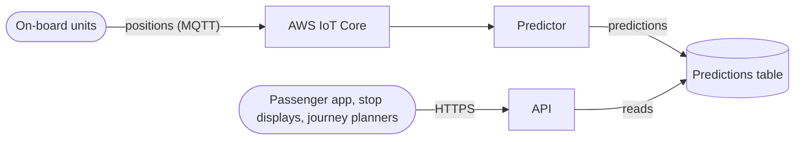

# Departures API

The Departures API tells bus passengers when the next buses will leave each stop. It takes the position that each bus reports every 10 seconds, predicts when the bus will reach each stop on its route, and serves those predictions to our passenger app, to the displays at stops, and to third-party journey planners.

## Purpose

Passengers need to know how long they'll wait for their bus, whichever app or display they check, and a wrong prediction is worse than none.

Non-goals:

- Journey planning, which third-party planners do with our predictions.
- Tracking passengers: the system never learns who is asking.

### Users and other stakeholders

- **Passengers**: Check departures in our app, on a journey planner, or on a display at the stop, often over a slow mobile connection.
- **Client organisations**: Our app team, the contractor that runs the stop displays, and each journey planner. Each has an API key, and a quota of requests per minute.
- **Operators**: Our platform team of two, who need to tell whether predictions are fresh and accurate without asking a developer.

## Components

- **Predictor**: A container on Amazon ECS, which reads positions from AWS IoT Core, and writes a prediction for each bus and stop to the predictions table.
- **Predictions table**: An Amazon DynamoDB table of the latest prediction for each bus and stop, where each item expires after 2 hours. It isn't backed up, since the predictor rebuilds it within a minute from the buses' positions.
- **API**: A container on Amazon ECS, behind an Application Load Balancer, serving `GET /v1/stops/{stop_id}/departures`. It authenticates each client organisation by its API key, and enforces its quota.

## Dependencies

The system is deliberately coupled to AWS, where the rest of our services run, and it only contacts AWS endpoints in the `eu-west-2` region.

## Operability

- **Logs**: Each process writes JSON lines to standard output, which ECS ships to Amazon CloudWatch Logs, where they're kept for 30 days. Each line carries the route, the stop, the client organisation, the response status, and the latency. The logs hold no personal data, since the API never learns who a passenger is, and the load balancer's access logs are off.
- **Metrics**: Each process publishes CloudWatch metrics: requests by client organisation and status, latency, refusals for exceeding a quota, the age of the latest position on each route, and the error of each prediction, measured once the bus reaches the stop.
- **Alerts**: CloudWatch alarms notify the operator on call through Amazon SNS when the latest position on a route is more than 2 minutes old, or when more than 1% of the API's responses are errors for 5 minutes.
- **Shutdown**: On `SIGTERM`, each process stops taking work, and exits within ECS's 30-second grace period.
