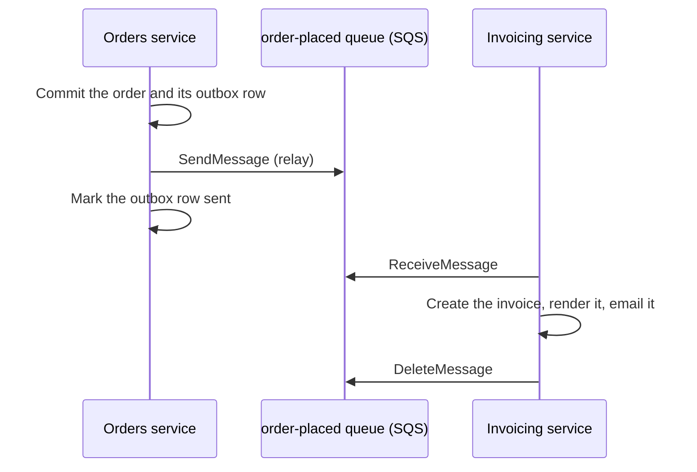

# Summary

Checkout fails whenever the invoicing service is down, because the orders service waits for invoicing to create each invoice before it confirms the order. This change hands each new order to invoicing through an Amazon SQS queue instead, so that checkout no longer depends on invoicing being up. Customers will get their invoice by email shortly after their order confirmation, rather than with it.

# Problem

When a customer places an order, the orders service calls `POST /invoices` on the invoicing service, and only confirms the order once that call returns `201`. If invoicing is slow or unavailable, the call times out after 10 seconds, and checkout shows the customer an error even though their payment was authorised. This happened three times last quarter, for 40 minutes in all.

Confirming an order doesn't need its invoice: our terms only promise that the invoice reaches the customer within an hour.

# Non-goals

- Changing how invoices are numbered, rendered, or emailed.
- Moving any other call between the two services onto a queue.

# Proposed solution



## Orders publishes an `order.placed` message for each order

The orders service writes each new order and a row in its `outbox` table in the same PostgreSQL transaction. Every second, a relay in the orders service sends each unsent outbox row to the `order-placed` queue, and then marks the row sent. If the relay stops between sending a message and marking its row, it sends that message again when it restarts.

This keeps each order and its message consistent without a distributed transaction, at the cost of up to a second's delay before invoicing sees the order.

### The queue is an SQS standard queue

A standard queue delivers each message at least once, and doesn't guarantee the order of delivery, which invoicing doesn't need. It keeps undelivered messages for 14 days, and encrypts them at rest with SQS-managed keys. We rejected a FIFO queue, since nothing depends on the order of the messages.

### The message carries the order, but not the customer's details

The body is JSON, with the `schema_version` message attribute set to `1`:

```json
{
  "order_id": "1f0c3a52-8d4e-4b7a-9a61-2f3e5c7d9b10",
  "customer_id": "7b2e9c14-3f6a-4d58-8e0b-5a1c2d3e4f60",
  "placed_at": "2026-11-02T14:03:27Z",
  "currency": "GBP",
  "lines": [
    { "sku": "MUG-BLUE-350", "quantity": 2, "unit_price_minor": 1200 }
  ],
  "total_minor": 2400
}
```

`order_id` and `customer_id` are UUIDv4s. Orders already caps each order at 100 lines, which keeps the message well under SQS's 256 KB limit. Invoicing looks up the customer's billing name, address, and email address in its own records, as it does today.

## Invoicing consumes the queue

Invoicing long-polls the queue for up to 10 messages at a time. For each message, it:

1. Inserts a row in its `invoices` table, numbered from a PostgreSQL sequence.
2. Renders the invoice as a PDF, and stores it in its S3 bucket.
3. Emails the PDF to the customer through Amazon SES.
4. Deletes the message from the queue.

If any step fails, invoicing leaves the message on the queue, and SQS delivers it again once its 5-minute visibility timeout expires. Invoicing keeps retrying the message this way until it succeeds, or until SQS discards it after 14 days.

## Permissions

The relay's IAM role can only send messages to the queue, and invoicing's can only receive and delete them.

## Observability

Both services log each message that they send or process, with its `order_id`. A CloudWatch alarm on the queue's `ApproximateAgeOfOldestMessage` warns the on-call engineer at 15 minutes, and pages them at 40 minutes, so that a stuck queue is dealt with before invoices break the one-hour promise.

# Impact on stakeholders

## Limitations

- **Customers**: Whilst invoicing is up, their invoice arrives within a minute or so of their order confirmation.

## Residual risks

- **An invoicing outage of over an hour**: Customers get their invoice later than our terms promise. The alarm pages the on-call engineer well before then.
