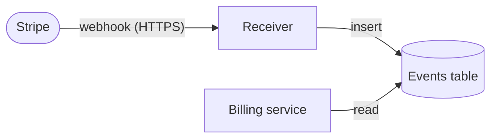

# Payment events receiver

The payment events receiver accepts each webhook that Stripe sends when a customer's payment succeeds, fails, or is refunded, and stores its event so that the billing service can update the customer's subscription. Stripe signs each webhook, and keeps resending it until our endpoint responds with a `2xx` status.

## Purpose

Billing must learn of every payment outcome within a minute, so that nobody keeps a subscription they didn't pay for, or loses one they did. Today, billing polls Stripe's API every 15 minutes, which delays every change and runs into Stripe's rate limits.

Non-goals:

- Acting on the events, which is billing's job, as described in its own architecture document.
- Calling Stripe's API: the receiver only listens.

Deferred decisions:

- Whether services other than billing will read the events.

### Users and other stakeholders

- **Billing service**: Needs each event within a minute of Stripe sending it, and the same event no more than once.
- **Customers**: Their access to the product depends on billing seeing each of their payments. Stripe's events carry their name and email address.
- **Operators**: Need to tell whether events are arriving, and why any were refused.

## Components

- **Receiver**: A container on Amazon ECS, behind an Application Load Balancer and AWS WAF, serving `POST /webhooks/stripe`. It runs as two tasks, and scales out on CPU. For each request, it:
  1. Refuses a body over 256 KB with `413`.
  2. Checks the `Stripe-Signature` header against the endpoint's signing secret, and refuses an invalid signature, or one more than 5 minutes old, with `400`.
  3. Responds with `200`, so that Stripe never waits on the database.
  4. Inserts the event into the events table from a background task in the same process. If the database is unavailable, it retries up to three times with exponential backoff and jitter, and then logs the event's ID at `ERROR`.
- **Events table**: The `stripe_events` table, in the Amazon RDS for PostgreSQL instance that billing already uses.
  - Columns: `event_id` (Stripe's event ID, the primary key), `type`, `api_version`, `created_at`, `received_at`, and the IDs of the customer, subscription, and invoice that the event refers to. The receiver drops the rest of the payload, including the customer's name and email address, which billing doesn't need.
  - The receiver inserts with `ON CONFLICT (event_id) DO NOTHING`, so a redelivered event is stored once.
  - The receiver's database role can only insert into the table, and billing's can only read it.
  - Rows are deleted 90 days after they're received, by a daily `pg_cron` job. Billing processes each event within minutes, and 90 days covers the investigation of a payment dispute.
  - The instance's automated backups cover the table, with 7 days of point-in-time recovery.

## Dependencies

The design is deliberately coupled to AWS, where the rest of our product runs.

- **Stripe**: Sends each event at least once, and resends it with exponential backoff for up to three days until it gets a `2xx`. We trust it to sign events with a secret that only it and the receiver know.
- **Amazon RDS for PostgreSQL**: Stores the events. Whilst it's unavailable, events wait in the receiver's background retries.
- **AWS Secrets Manager**: Holds the signing secret, which only the receiver's task role can read.

## Operability

- The receiver logs each request (the event's ID and type, and the response status) to standard output, which ECS ships to CloudWatch Logs, where it's kept for 30 days.
- CloudWatch metrics count requests by status, refused signatures, and insert attempts and failures, and measure insert latency.
- An alarm warns the operators when more than 10 signatures are refused in 5 minutes.
- On `SIGTERM`, the receiver stops accepting requests, and exits within ECS's 30-second grace period.

## Threats

- **Forged events**: Refused by the signature check. Anyone who obtains the signing secret can forge events until it's rotated in Stripe's dashboard.
- **Replayed events**: Refused once their signature is more than 5 minutes old, and stored only once by event ID.
- **Floods**: AWS WAF only admits Stripe's published webhook IP addresses, and limits each one to 1,000 requests per 5 minutes.
