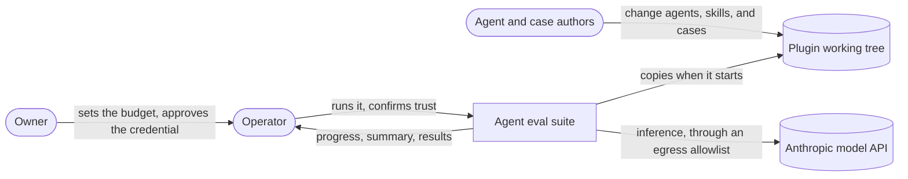
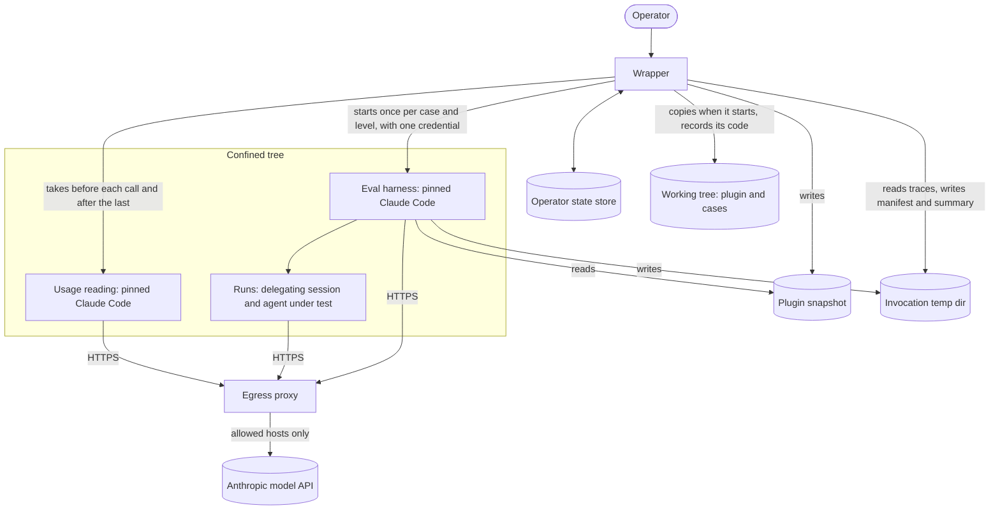

# Agent eval suite

<!-- cspell:words cspell AppArmor Dependabot lockfile seccomp tmpfs worktrees -->

The agent eval suite measures how reliably the `sdlc` plugin's agents behave as their definitions say: whether each agent keeps to its priorities and principles, escalates the hazards it must, stays within its domain, and reviews artefacts and processes feedback as required. Each agent is a Claude Code subagent, defined by a prompt and the skills it preloads, so the only way to observe its behaviour is to run it on a model many times and grade what it did. The suite runs on demand on the operator's Linux machine, through Claude Code's plugin eval harness. It uses Opus 5.5 at the `low` effort level, unless the operator asks for other levels. The suite confines everything that the harness starts, so the agents under test cannot reach the operator's files, sockets, or accounts.

## Purpose

The plugin's agents and skills change often, and agents make many of the changes. A change to a definition or a skill can alter whether an agent loads the skills it must, asks before introducing a hazard, leaves work outside its domain to others, or lets an earlier priority win over a later one. Nobody notices until a caller depends on that behaviour.

The owner needs to know how often each agent behaves as its definition says at the lowest effort level expected to be good enough, which is `low` on Opus 5.5. They need to find out on demand, for any working tree, at a cost they have agreed to. Now and then, they also need to know whether a higher level behaves differently, since a pass at `low` doesn't prove anything about a higher level.

Each answer must be attributable: a failure must show whether the agent, the case, or the infrastructure was at fault. The measurements must also be extensible, since later suites will test how each agent observes its paired skill (e.g., the programmer and the `programming` skill).

### Non-goals

- Running in CI or on a schedule.
- Measuring adherence to the `escalation` and `artefact-review` skills beyond what the agent definitions require.
- Agent-specific behaviour, which later suites add.
- Keeping results once the machine clears its temporary directory.
- Publishing reports, or sharing results beyond the operator's machine.
- Running on macOS or Windows.
- Testing an agent as a session's main agent. Claude Code does not preload an agent's skills when it starts a session as that agent, and the harness cannot start a session as an agent.

### Deferred decisions

A pilot of one case, with one run per level, settles the following before the full suite is built. Its spend counts against the budget.

- How each run confirms the effort level that the agent under test ran at: from the trace if it shows the level, or else with a dedicated canary case. If neither works, the levels cannot be confirmed, and the owner is told so before the full suite is built.
- Whether graders can tell the skills that the agent under test loads from those that the delegating session loads.
- The cost and duration of a run at each level, and the delegating session's share of the cost. The delegating session moves off Opus 5.5 only if that share is material and a cheaper model delegates as reliably.
- Whether a minimal model request with the subscription's long-lived token reports the weekly utilisation. The wrapper's own readings are the budget's only source of it.
- Whether the confined harness needs any host besides the model API.
- The space that a run takes in the temporary directory.

These decisions wait for evidence, or for the owner:

- **Isolating the confined tree's network in a namespace of its own**: This would stop a confined process from reaching another host on the proxy's port. On this machine it needs an AppArmor profile, and therefore root, so it is the owner's decision.
- **A confinement policy for macOS**.

### Users and other stakeholders

- **Operator**: Whoever runs the suite on their machine: today, the owner or an agent acting for the owner.
  - Needs: one entry point; a choice of agents, cases, and levels, with every case at `low` by default; visible progress; a summary per case and level that sets apart inconclusive runs and the failures of runs cut short; and a reason whenever the suite refuses to start or stops.
  - Constraints: a Linux machine with Landlock (kernel 7.0); a RAM-backed `/tmp` of 1.9 GB, shared with every session on the machine; and one user account, shared with the owner's other sessions and agents. The operator must also confirm trust in each new worktree in person.
  - Leading alternative: running Claude Code's plugin eval harness directly. That is simpler to set up, works on macOS, and accepts any option. But it leaves the operator's machine within reach of whatever a run executes, has no weekly spending limit, records nothing that ties a result to the code that produced it, and counts infrastructure failures against the agents. On platforms the suite does not support, it is the operator's only option.
  - Trust: the owner trusts the operator with the credential (and so with the subscription's allowance or the API key's spend), and with deciding which checkouts may run.
- **Owner**: Signs off the plugin, sets the budget, and approves the credential. Only the owner can unblock the subscription budget after an invocation that could not measure its spend. The owner's constraints are:
  - Every subscription eval run, the pilot included, stays within 10% of the weekly allowance.
  - The suite runs on Linux, and Node may be installed for it.
  - For the implementation, the wrapper is written in Python, like the rest of the repo. It confines processes through an official nono library for Python where one does the job, or else through the nono binary. Today the library does not do the job, so the wrapper uses the binary.
- **Agent and case authors**: The people and agents who change agents, skills, cases, or fixtures, including those writing later agent-specific suites.
  - Needs: a way to add cases next to the existing ones without changing any contract, and results they can attribute.
  - Their changes are untrusted until the operator confirms trust in the checkout. Even then, code they add cannot run unless the suite allows its kind.
  - Leading alternative: trying an agent by hand in their own session. That is cheaper for a single check, but it cannot be repeated or attributed.
- **Other sessions and agents on the owner's account and machine**: They share the subscription's allowance and rate limit, the machine's `/tmp`, the user account, and the configuration of every repository they work in, without having chosen to. The budget caps their loss of the weekly allowance at 10%, plus what the last harness call spends, but caps nothing over a shorter window. The free-space check protects their space in `/tmp`.
- **People who install the plugin**: The marketplace installs the whole repository, so the suite and its fixtures reach every installation. They pay in disk space, and receive whatever the fixtures contain.
- **Anthropic**: Receives every prompt, fixture, and output; serves the runs; and enforces the subscription's allowance or bills the API key.
- **The environment**: Bears the energy cost of every run.

## Principles

### 1. Nothing the suite runs can reach the operator's files, sockets, or accounts, or any host beyond those it needs

The runs carry out a model's choices on branches that agents may have written. They do so on the machine that holds the operator's credentials and live sessions. This optimises for the operator's safety at the expense of setup effort, portability (Linux only), and some fidelity, since runs cannot use tools that a caller might give an agent, such as a shell or the Web.

### 2. No code runs unless the suite allows its kind

Inside the confinement, only the pinned Claude Code and the one permitted fixture-copying step run. The suite refuses every other way for a plugin, a case, or a fixture to start code, unless an allowlist names it. The confinement cannot stop a process from sending the credential to any host on the proxy's port, so the credential stays on the machine only because no other code can run.

The same holds for what the wrapper runs on the operator's behalf, outside the confinement: nothing may run that a change names, or that the configuration of its repository names. For example, when the wrapper records the code, none of git's filters, hooks, pagers, or external commands may run.

The one exception comes before the wrapper starts. The wrapper runs through uv, which first reads the branch's `pyproject.toml` and `uv.lock`. A branch can use those files to make uv build the project, which runs a build backend as the operator. So they need the same careful review as the wrapper.

The cost is that each new kind of plugin component, case key, or metadata key needs a reviewed change to the suite.

### 3. Spend stays within what was approved, and is checked before it is incurred

On the subscription, all eval invocations together stop once they have raised the week's measured utilisation by 10 points, and only the harness call that crosses that mark can overrun it. With an API key, each invocation stays within a dollar cap that the operator gives, with no default. Where a reading is uncertain, the suite attributes spend in whichever direction stops it earlier, and where it cannot measure spend at all, it stops.

This optimises for the owner's allowance and money, at the expense of completeness and availability. An invocation can stop between harness calls, and the full set of runs may need trimming. An invocation that cannot measure its spend blocks the subscription until the owner clears it.

### 4. Agents are tested the way callers use them

- A main session delegates each case's request to the agent under test, which preloads its skills.
- Both sessions run on Opus 5.5, at the effort level under test.
- The plugin is tested as it stood in the working tree when the invocation started, uncommitted changes included.
- The agent under test can delegate in turn, as it can for callers. Claude Code's setting that forbids nested delegation also tells the agent to do the work itself. That would bias the cases that check whether the agent leaves work outside its domain to others.

This optimises for results that predict real use, at the expense of paying for the delegating session and for any agent that the agent under test delegates to.

The runs differ from real use in one respect. The harness turns remote feature flags off for every run, so the runs use the pinned Claude Code's defaults, whereas the owner's own sessions get flags remotely. Where a flag changes behaviour, the runs can therefore differ from the owner's sessions. In exchange, the runs behave the same way on every invocation of a given pin.

### 5. A run counts against an agent only when the agent caused its outcome

A run passes, fails, or is inconclusive. It is inconclusive whenever something other than the agent decided the outcome: the infrastructure, the harness, the confinement, the delegating session, the budget, or an effort level other than the one requested. A run cut short by its time or turn limit is inconclusive too, unless its trace already shows it doing something that its case forbids, which no later step could undo.

Rules decide whatever they can, and an LLM judge grades only what rules cannot, from criteria concrete enough to tell a pass from a failure. This optimises for trust in the results, at the expense of coverage, since the suite reports inconclusive runs without re-running them. It also biases the results against the agent, since a run cut short can fail but never pass.

### 6. Every result can be traced to what produced it

Each invocation records the code, the versions of the harness and of nono, the models, the effort level, the credential source, and the environment that produced its results. Every harness call in an invocation runs the same pinned harness against the same snapshot of the plugin. This optimises for attributing a change in results, at the expense of setup effort (Node, to install the pinned harness) and of trailing the operator's everyday Claude Code.

### 7. The suite adds only what the harness lacks

Claude Code's plugin eval harness already isolates each run, grades it, calls the judge, and caps spend. The suite adds the confinement, the code check, trust, the budget, effort levels, attribution, and the record. This optimises for building and maintaining less, at the expense of being bound to the harness's contracts and to one provider.

## Components

- **Wrapper**: The suite's only entry point, which the operator runs unconfined, under their own account.
  - It takes the plugin snapshot and checks it, asks the operator to confirm trust, and verifies the confinement.
  - It starts the egress proxy, then the confined harness once per case and level, so that it can check the budget between harness calls. It runs each case at every requested level before the next case, so an invocation that stops early still compares the levels on the cases it covered.
  - On the subscription, it takes the usage readings. It enforces spend, classifies every run, and writes the manifest and the summary.
  - It records the code without running anything that the working tree or its repository's configuration names.
  - It knows the credential, the spend ledger, and the trust answers. It trusts the operator, the pinned Claude Code, and the pinned nono.
  - It passes no other options through to the harness, so widening what a run can do takes a reviewed change to the wrapper.
- **Egress proxy**: Runs in the wrapper, unconfined.
  - It relays the confined tree's HTTPS connections to the hosts on its allowlist, on the HTTPS port only, and refuses and records the rest.
  - It also refuses an allowed host whose name resolves to an address that is not public, so that nobody can point an allowed name at the machine's own services.
  - TLS runs end to end through it, so it sees the host name, timing, and volume of each connection, but none of the content.
- **Plugin snapshot**: A copy of the plugin's manifest, agents, skills, and cases, which the wrapper takes into the invocation's temp dir when the invocation starts. It leaves out the wrapper's own code.
  - The code check checks it, the runs read it, and the manifest records what it holds, so what is checked is what runs.
  - It holds no git metadata. For a worktree, that metadata is the main repository's, with every local branch and the shared stash.
- **Confined harness**: Claude Code's plugin eval harness, at the version that the repository pins for its CI validation. It runs inside nono's confinement, which every process it starts inherits.
  - The pin must be at least the first release with a setting for a delegated agent's effort, which appeared after 2.1.312 and no later than 2.1.317.
  - Each harness call runs its case's runs one at a time, grades them, and calls the judge model.
  - Each case runs only with the plugin. The suite turns off the harness's default second set of runs without the plugin, since those would have no agent under test to delegate to.
  - It holds the credential in its environment, reads the snapshot and the pinned Claude Code, writes only to its call's directory in the invocation's temp dir, and reaches the network only through the proxy. It cannot read the working tree.
  - It gets a fresh home and configuration of its own for each call, so it shares no state with the operator's Claude Code.
  - Its own isolation of each run still applies within the confinement: a temporary home and configuration, a filtered environment, the case's graders and other case material out of the agent's reach, no claude.ai connectors, and no published report.
- **Runs**: One Claude Code session per run of a case. Its main session delegates the case's request to the agent under test, which preloads its skills. Both use Opus 5.5 at the level under test.
  - Tools: reading and searching the run's workspace and the plugin, loading skills, delegating, and writing within the workspace. A case can withhold writing.
  - No tool that executes commands, reaches the Web, or acts beyond the workspace.
  - The trace records the tool calls of the main session and of the agent under test (whose calls carry a `parent_tool_use_id`), but only progress summaries of a nested agent's calls.
  - Each run is cut short at its case's time limit (4 minutes at most) or turn limit.
  - Each run knows only its case's prompt and fixture.
- **Usage reading**: On the subscription, one minimal model request from the pinned Claude Code, whose response reports the seven-day utilisation and the week's reset time.
  - It runs under the same confinement and with the same credential as the harness, and knows nothing else.
  - The wrapper takes one before each harness call, and one after the last.
- **Case suite**: The cases, which sit in the working tree with the plugin.
  - Every agent gets the same kinds of case, each with a scenario in that agent's own domain:
    - Review (implied, explicit, and a negative).
    - Feedback.
    - Domain (and a negative): the agent passes by declining the work outside its domain or handing it to another agent, and fails by doing the work itself.
    - A hazard that requires confirmation (and a negative, with the hazard acknowledged up front).
    - Priorities.
  - That makes nine cases per agent, 36 in all. Each case is tagged with its agent and runs three times per level.
  - Rules grade what they can: which agent the main session delegated to, whether it passed the case's request on, which session loaded a skill or made a change, and whether a fixture file changed. The judge grades the rest.
  - Each run's workspace starts as a copy of its case's fixture. Fixtures hold nothing that looks like a credential, no Claude Code configuration, and no git metadata.
  - Later suites add cases next to these, under the same contracts.
- **Operator state store**: A directory at the account's own `~/.local/state/sdlc-evals`, outside the confinement. The environment cannot change the location, so every invocation under the account shares one lock and one ledger. Only the operator's account can read it, and only the wrapper does. It holds:
  - The spend ledger, with an entry for each invocation. The entry holds the invocation's credential source and list-price spend. On the subscription, it also holds the first and last readings in each week that the invocation's readings touch, keyed by the week's reset time, or a provisional charge whilst a harness call is running. The wrapper deletes entries whose week has reset, except a provisional charge, which stays until the owner clears it.
  - The operator's trust answers, one per worktree. Each identifies its worktree by its path and by its identity on the file system, so the operator is asked afresh about a new worktree at an old one's path. The wrapper deletes an answer once its worktree no longer exists. Where the file system cannot tell worktrees apart by identity, the wrapper asks every time.
  - The subscription token, until the operator replaces it or it expires a year after it was issued.
  - The invocation lock, which exists only whilst an invocation holds it.

  The ledger and the trust answers carry a format version from their first release, since later versions of the wrapper must read them. The store holds no API key, and nothing backs it up. Its writes are atomic, and each reaches the disk before the wrapper goes on, so a crash or a power cut leaves either the old document or the new one.
- **Invocation temp dir**: One per invocation, under the temporary root (by default the machine's RAM-backed `/tmp`). Only the operator's account can read it. Within it, the confined tree can write only to the directory of the harness call or reading that is running.
  - It holds the plugin snapshot, each run's sandbox until the run's trace is copied, and then the traces, the harness's reports, the manifest, and the summary. The wrapper prints its path.
  - It stays until the operator deletes it or the machine clears `/tmp`.
- **Working tree**: The plugin under test, the case suite, and the wrapper. The confined tree cannot read it. The suite writes nothing into it, even when the harness is run directly.

### An invocation

1. The operator chooses the agents, the levels, and the credential source. By default, the suite runs all agents at the `low` level, on the subscription. It uses an API key only when the operator chooses one and gives a dollar cap.
2. The wrapper takes the operator's invocation lock, which only one invocation at a time can hold under the operator's account. The operating system releases it when the wrapper exits, so a crash cannot leave it behind. If another invocation holds it, the wrapper names that invocation and refuses to start.
3. The wrapper takes the plugin snapshot, and refuses to start unless each of the following holds:
   - Every case uses permitted keys only, which exclude a case-level plugin.
   - No case lets a run last more than 4 minutes.
   - Every case uses the one permitted fixture-copying step.
   - No fixture holds Claude Code configuration or git metadata.
   - The plugin's root holds only permitted entries.
   - The plugin's manifest declares only agents and skills.
   - Agent and skill metadata use permitted keys only.
   - No agent or skill embeds a shell command.
4. If the operator has not yet confirmed trust in this worktree, the wrapper asks them before anything runs. It asks at the controlling terminal, so that a process that only controls standard input cannot answer. The harness treats the plugin as trusted only after a yes.
5. Before starting, and without any model call, the wrapper checks the confinement from a process two levels below its root, at the same depth as the runs. The check must find the following denied:
   - Reading the operator's Claude Code configuration and SSH keys.
   - Reading the working tree and its repository's git metadata.
   - Writing outside the invocation's temp dir.
   - UDP, and TCP to any port but the proxy's.
   - Requests through the proxy to hosts that are not on the allowlist.
   - Connecting to the sockets in the operator's runtime directory, and to abstract Unix sockets.

   It must find the following allowed: reaching the model API through the proxy, running what the fixture-copying step and the harness's search tool need, and starting the pinned Claude Code. If any check fails, the wrapper refuses to start.
6. For each case in turn, at each requested level in turn:
   - On the subscription, the wrapper takes a reading, and replaces the previous call's provisional charge with the measured charge. If the reading fails, the wrapper stops, or refuses to start if no call has run yet.
   - It checks the spend and the free space, and stops if either is too low for the next harness call. On the subscription, it then records a provisional charge.
   - It starts the confined harness for the case, with the level's effort for both sessions, the call's spend cap, and exactly one credential. Progress reaches the operator as it happens.
   - Afterwards, it stops every process that the call left behind, copies the traces, deletes the sandboxes, classifies the runs, and records the spend.
   - It then compares the tools each run was offered with those the suite expects. If a new tool appeared, it voids the call, names the tool, and stops.
7. On the subscription, the wrapper takes a final reading after the last harness call, even after an interruption or a timeout, and replaces the last provisional charge with the measured charge. It then writes the manifest and the summary, releases the lock, and exits with a status.

### Outcomes and records

- **Outcome of a run**: Each run ends up in one of three states.
  - Passed: it completed, and every grader passed.
  - Failed: it completed, and a grader failed. A run cut short by its time or turn limit also fails if it failed a prohibition of the trace, unless one of the other causes below applies.
  - Inconclusive: something other than the agent decided the outcome, and the run is labelled with the cause. The causes are:
    - A harness or API error.
    - A timeout or the turn limit, unless the run had already failed a prohibition of the trace.
    - A delegation that did not happen as asked, as the trace or the delegation graders show.
    - An effort level other than the requested one.
    - A sandbox denial (a tool result flagged as an error because the confinement refused an operation).
    - A grader that could not run, such as the judge, which the harness skips once the spend cap is reached.
    - A run that never ran, or whose harness call's result could not be read.
    - A harness call voided by an unexpected tool.

  A _prohibition of the trace_ is a grader of the trace that only forbids something: a `regex` grader on the trace with `match: not_contains`, or a `tool_used` grader whose minimum is zero (the harness takes a missing `min` as 1). Whether a grader is one follows from its definition alone, and the trace only grows. So a prohibition that failed when the run was cut short would still fail at its end.

  No other grader counts on a run cut short, whether it passed, failed, or could not run. The judge doesn't count, since the run has no final answer. Neither does a grader of the workspace (`file_exists`, or `regex` on a file), since a later edit could have changed the workspace. So the wrapper never reads a file to classify a run.

  Pass counts cover completed runs and the failed runs that were cut short. The suite retries nothing itself, since Claude Code already retries API errors with backoff.
- **Summary**: Pass counts per case and level, with the failures of runs cut short set apart from those of completed runs. It also lists the inconclusive runs with their causes, the chosen cases that did not run, how many runs had their effort confirmed, the proxy's refusals, and each level's spend.
- **Manifest**: One per invocation, with a format version. It records:
  - The commit that the snapshot was taken from, and any diff between them in the agents, skills, and suite, untracked files included.
  - The wrapper's own uncommitted changes, including untracked files and changes to `pyproject.toml` and `uv.lock`.
  - The versions of Claude Code and nono, and the model that each run used.
  - The judge model, the effort level, and the credential source (never the credential itself).
  - The environment that was set, and the agents, cases, and levels chosen.
  - On the subscription, every utilisation reading that the wrapper took, with its week's reset time.
  - The proxy's refusals, its failures to reach an allowed host, and the exit statuses.
- **Exit status**: Distinguishes every case meeting the threshold, a case below it, inconclusive runs, the spend cap, spend that cannot be measured, a refusal to start, and an interruption. This is a contract with whoever calls the wrapper, agents included, so it only changes by addition.

### Spend

- **Subscription**: All eval invocations together, the pilot included, may raise the seven-day utilisation by at most 10 points a week. Only measured utilisation counts: list-price spend is recorded and reported, but plays no part in this budget.
  - The suite's long-lived token cannot read the subscription's usage, so the wrapper takes usage readings of its own: one before each harness call, and one after the last, even after an interruption or a timeout. Every request of the invocation, the judge's included, therefore falls between two readings. The runs' traces carry readings too, but the budget never uses them, so a change in what the traces carry cannot affect it.
  - Readings are in whole percentage points at best, and the owner's other sessions move them too. Attributing all of the change to the evals overestimates their share, so it can only make the suite stop earlier.
  - For each week that an invocation's readings touch, the invocation is charged its last reading in that week minus its first, plus 1 point for the rounding of the two. If the week began during the invocation, its first reading in that week is taken as zero, since utilisation restarts at the reset. Spend in a week that has already reset counts against nothing.
  - Before each harness call, the wrapper uses that call's fresh reading to add the invocation's charge for the current week to the week's other charges in the ledger. It stops once the total reaches 10 points, so the week can exceed 10 points only by what the last call spends, which the next reading records.
  - Each harness call also gets a fixed dollar cap (e.g., $5 for a case's three runs), which bounds a call that goes wrong, whatever the readings show.
  - Before each harness call, the wrapper records a provisional charge for the rest of the week's budget, and replaces it with the measured charge once the next reading is in. A provisional charge does not expire with its week, since a call can run across the reset. If the wrapper dies during a call, or a reading fails, the provisional charge stays, and blocks every subscription invocation until the owner clears it.
  - Only the owner can clear a provisional charge, in person. The wrapper's command for it asks at the controlling terminal, as it does for trust, and tells the owner to check their usage first. Clearing it leaves the invocation charged what its readings measured before the call that was running.
  - If the first reading fails, the invocation makes no harness call, and exits with the status for spend that cannot be measured. Only that reading's request is spent, and it is not charged. A later reading that fails stops the invocation with the same status.
- **API key**: There is no weekly allowance. The operator gives a dollar cap for the invocation, with no default, and the wrapper refuses to start without one. The wrapper gives each harness call what remains of that cap, and stops once it is spent. It charges a call its full cap if the call is interrupted or times out, or if its result cannot be read, since what it spent is then unknown.
- **Both**:
  - Only one invocation runs at a time under the operator's account, so two invocations cannot each spend the same remaining budget, even when separate agents start them from different worktrees.
  - Runs go one at a time, which leaves most of the rate limit to the owner's other sessions.
  - The harness checks a call's cap before launching each run, so a call can overrun its cap by at most one run.
  - When a harness call ends, times out, or is interrupted, the wrapper stops every process that the call started, so that no run outlives its call and keeps spending.
  - A new harness version that offers a new tool wastes at most one harness call.

### Failure modes

| Failure | Whose fault | Response |
| --- | --- | --- |
| The code check fails | The change under test | Refuse to start, naming what failed |
| The operator does not confirm trust, or there is no terminal to ask at | The operator's decision | Refuse to start |
| A confinement check fails | The platform or the policy | Refuse to start, naming the check |
| The pinned Claude Code or nono is missing, or nono's binary does not match its pinned hash | The operator's set-up | Refuse to start, saying what to install |
| The state store is unreadable | The infrastructure | Refuse to start, since the budget cannot be checked |
| Another invocation is running | The operator's scheduling | Refuse to start, naming the other invocation |
| A utilisation reading fails | The infrastructure, or the provider | Stop with the status for spend that cannot be measured (before the first harness call, refuse to start), leaving any provisional charge in place |
| The wrapper dies during a harness call | The machine, the operator, or the wrapper | The provisional charge blocks every subscription invocation until the owner clears it in person |
| A provisional charge blocks the subscription | A failed earlier invocation | Refuse to start, saying that the owner must clear it |
| Not enough free space for a harness call | The infrastructure | Stop before that call, keeping earlier calls' results |
| A harness call reaches its dollar cap | The approved budget | The harness stops launching runs and skips the judge; those runs are inconclusive |
| The week's budget, or the API key's cap, is spent | The approved budget | The wrapper stops before the next harness call, with the spend-cap status |
| The model API fails or rate-limits a request | The infrastructure | Claude Code retries with backoff; if the request still fails, the run is inconclusive, and not retried again |
| The proxy refuses a host | The policy (a missing host) or the confined tree | Recorded and reported; a run that fails as a result is inconclusive |
| The confinement refuses an operation in a run | The policy | The run is inconclusive (sandbox denial) |
| A run is offered a tool the suite does not expect | The harness version | The harness call is voided, and the wrapper names the tool and stops |
| The main session does not delegate as asked | The delegating session | The run is inconclusive |
| The agent ran at another effort level | The harness or the account | The run is inconclusive |
| A completed run fails a grader | The agent, or the case | The run fails |
| A run reaches its time or turn limit | The agent, if it had already failed a prohibition of the trace; otherwise unknown (the agent, or a slow API) | The run fails in the first case, unless another cause makes it inconclusive, and is inconclusive in the second |
| The harness exits abnormally, times out, or leaves no readable result | The harness | The wrapper stops every process the call started, and the call's unfinished runs are inconclusive; the next reading measures what it spent, or, with an API key, the call is charged its full cap |
| The operator interrupts an invocation | The operator | The wrapper stops every process the call started, takes its last reading (with an API key, charges the call its full cap), records what it has, and stops |

## Dependencies

The suite is coupled to Anthropic on purpose, since it exists to test Claude Code agents on Anthropic's models. Only nono is meant to be replaceable: any kernel-enforced confinement with the same properties would do.

### Backing services

Only the owner deploys the suite, so these are named by product.

- **Anthropic model API**: Inference for the runs and the judge. With the subscription, it also enforces the weekly allowance, and its responses report the seven-day utilisation that the subscription budget depends on. With an API key, it bills the key. Stakeholders trust it with every run's availability, and with every prompt, fixture, and output, which hold no personal data beyond what the fixtures contain.
- **Anthropic account**: Issues the credential, which is either an API key or an inference-only token, made for unattended jobs and valid for a year. That token cannot read the subscription's usage. The suite does not contact the account during an invocation.

### Delegations

- **Claude Code's plugin eval harness, pinned**: Isolating each run, grading, calling the judge, and capping spend per invocation. Its caveats are:
  - It has no option for effort, for a matrix of levels, or for a main agent. So the wrapper sets effort through the environment, and each level needs a harness call of its own.
  - It runs each case's setup step as the operator, outside its own sandbox. That is why the confinement and the allowlists exist.
  - It turns non-essential traffic off for every run, which also turns remote feature flags off, so the runs use the pinned version's defaults. The suite turns non-essential traffic off for the harness too, so that only inference leaves the machine.
  - It reads the plugin's git metadata, which is why the runs get a snapshot without any.
  - It records neither the commit nor the model used.
  - It deletes traces unless told to keep them.
  - By default, it publishes its report to claude.ai whenever the account allows it, as a remote flag decides. So the suite always tells it not to.
  - By default, it writes results inside the plugin.
  - It skips the judge for a run once the spend cap is reached, and marks that run's LLM graders as failed.
  - It grades a run that it cuts short as it would a completed one, judge included.
  - Its behaviour changes between patch releases: for example, a patch release added the setting for a delegated agent's effort. So the version is pinned, and only a reviewed change moves it.
- **Claude Code, running the runs and the usage readings**: Delegation, skill preloading, reporting the utilisation that the API returns, and retrying API errors with backoff. Its caveats are:
  - A remote experiment can lower a delegated agent's effort unless the effort is set explicitly, so it always is.
  - A settings maximum or an organisation cap can lower the effort without saying so, which is why each run must confirm it.
  - Only its own honouring of the proxy settings keeps it to the allowed hosts.
  - Given two credentials, its order of precedence would pick one without saying which, so the wrapper passes exactly one.
  - Its trace carries only progress summaries of a nested agent's tool calls, which lets a grader of the trace tell the agent's own calls from a nested agent's. A version that recorded a nested agent's calls with a `parent_tool_use_id` would fail an agent for delegating.
- **nono's binary, through Landlock and seccomp**: Kernel-enforced confinement, which every descendant inherits. Its caveats are:
  - It is used on Linux only, for now.
  - It has not reached version 1.0. It is pinned to an exact release, at least the one that fixes every advisory published before it, and the wrapper checks the binary's hash against the pin on every invocation.
  - The wrapper does not use nono's official library for Python. The library's current release embeds an older nono with unfixed advisories, and captures a child's output, which the wrapper must stream. It also does not mediate Unix sockets by path, so a confined process could reach the operator's D-Bus session bus.
  - It limits TCP by port only, so the proxy's port is open to every host. Its network-namespace isolation would close that, at the cost described under the [deferred decisions](#deferred-decisions).
  - A Unix-socket peer that the policy allowed could hand over a connected socket, but the policy allows none.
- **Node and npm**: Installing the pinned Claude Code, verified against the hashes in the repository's lockfile. They run at install time only, unconfined.
- **git, 2.44 or later**: Recording the commit and the uncommitted changes. It reads the repository's configuration, which every worktree of the repository shares. An agent in any of them can change that configuration without the change showing in any diff. The configuration can name commands for git to run, such as filters, so the wrapper only uses git commands that run none of them, which need git 2.44 or later.
- **uv**: Running the wrapper, on the Python version that the repository pins. Before the wrapper starts, a branch can use `pyproject.toml` and `uv.lock` to make uv build the project, which runs a build backend as the operator, unconfined. Telling uv not to build does not stop it.
- **The operator's Linux machine**: Landlock and seccomp. Its caveats are:
  - `/tmp` is a RAM-backed tmpfs, shared with every session.
  - The suite shares one user account with the owner's other sessions and agents, so no operating-system boundary separates the state store from them.
  - Unprivileged user namespaces are restricted, which is why nono's network-namespace isolation needs an AppArmor profile.
- **Dependabot**: Proposes bumps of the pinned harness as pull requests. A merged bump can bring new tools or components, which the tool check and the allowlists then refuse.

### Hosts contacted

| Host | Contacted by | Why |
| --- | --- | --- |
| Anthropic model API (`api.anthropic.com`) | The harness, the runs, and the usage readings | Inference, for the runs and the judge, and the subscription's utilisation |

The suite contacts nothing else during an invocation:

- Telemetry, error reporting, update checks, and remote feature flags are switched off.
- The suite never contacts claude.ai.

Outside any invocation, installing the suite contacts the npm registry for the pinned Claude Code, and GitHub for nono's release.

### Legal and contractual obligations

- **Anthropic's terms for the credential used**: For the subscription, these are the consumer terms, together with the owner's privacy settings, which decide whether sessions may be used for training and how long they are kept. For an API key, they are the commercial terms. The design relies on them for how prompts, fixtures, and outputs are kept and used. A breach would expose the suite's prompts and fixtures, which the repository already publishes, and the models' outputs.
- **The subscription's permitted uses**: The design relies on long-lived tokens being meant for unattended jobs, as Claude Code itself describes them. If that changed, subscription runs would fail as inconclusive, and the operator could switch to an API key.

## Relevant standards

- **HTTP CONNECT tunnelling through a proxy ([RFC 9110](https://www.rfc-editor.org/rfc/rfc9110#name-connect))**: Adopted for egress. Claude Code honours the conventional proxy settings, and TLS stays end to end, so the proxy sees host names only.
- **[XDG Base Directory Specification](https://specifications.freedesktop.org/basedir-spec/latest/)**: Adopted in part. The operator state store sits at the specification's default state directory, but the wrapper ignores `XDG_STATE_HOME` (and `HOME`), so that a caller's environment cannot give an invocation a lock and a ledger of its own.
- **OAuth 2.0 Token Revocation ([RFC 7009](https://www.rfc-editor.org/rfc/rfc7009))**: Claude Code revokes its own login through such an endpoint, which could serve to revoke the subscription token. Not adopted, since the owner chose not to test whether the endpoint accepts that kind of token.
- **[OpenTelemetry](https://opentelemetry.io/)**: Not adopted. The manifest and the summary are local, and they meet one operator's needs.

## Impact on stakeholders

### Limitations

- **Linux only**: Operators on macOS or Windows bear this. Their workaround is to run the harness directly, without the suite's protections.
- **Slow**: Runs go one at a time, so a full run at `low` takes about 1.5 hours, and up to about 7 if every run reaches its 4-minute cap. Each further level adds as much again. The operator bears this, and can run a subset of agents instead.
- **Routine runs only test `low`**: A regression that only shows at a higher level goes unnoticed until someone runs that level. The owner bears this, and can run other levels on demand.
- **A run cut short can fail but never pass**: So wherever runs are cut short, the pass counts understate the agent. The owner and the authors bear this, and the summary sets those failures apart.
- **Telling the agent's own calls from a nested agent's relies on the pinned trace format**: A bump of the pin that recorded a nested agent's calls as the agent's would fail it for delegating. The owner bears this, and the next full run would show it.
- **In three of the four domain cases, only the judge decides whether the agent handed the work to another agent**: It decides from the answer, so an agent that did the work itself and said otherwise would pass. The owner bears this, and the run's trace shows whether the agent delegated.
- **One invocation at a time**: Agents acting for the owner in different worktrees must take turns, since the wrapper refuses a second invocation and does not queue it. They bear this, and can start again once the first invocation ends.
- **The budget only counts invocations under this account on this machine**: The ledger misses invocations on the same subscription from another machine or user account. The owner bears this, and avoids it by running the suite from one machine and account only.
- **The last harness call can take the week past 10%**: The wrapper checks the budget before each call, so the call that crosses 10 points runs to its end, within its dollar cap. The owner bears this, and the next reading records the excess, so no further invocation runs that week.
- **Each invocation costs at least a point**: The point added for rounding limits the week to ten invocations, however small. The operator bears this, and can cover more agents or levels in each invocation instead.
- **Nothing caps the suite's share of a shorter usage window**: The readings only carry the seven-day window, so a full run can use much of its 10 points in one sitting, leaving less of any shorter window to the owner's other sessions. The owner bears this, and can run the suite in subsets.
- **An invocation that cannot measure its spend blocks the subscription**: If the wrapper dies during a harness call, or a reading fails, no subscription invocation can run until the owner clears the provisional charge in person. The operator and agents acting for the owner bear this, and can use an API key in the meantime.
- **The subscription cannot be used without readings**: If the provider stops reporting the utilisation to the long-lived token, every subscription invocation refuses to start. The owner bears this, and can use an API key instead.
- **Runs use default feature flags**: Behaviour that a remote flag changes in the owner's sessions goes untested. The owner bears this, and there is no workaround, since the harness forces it.
- **Results do not persist**: The machine clears them along with `/tmp`. The operator bears this, and can copy the temp dir before it is cleared.
- **No unattended start in a new worktree**: The operator must confirm trust in person, so an agent cannot start the suite in a new worktree on its own. Where the file system cannot tell worktrees apart beyond their paths, the operator is asked on every invocation. Agents acting for the owner bear this, and there is no workaround.
- **The effort levels might be impossible to confirm**: If the pilot finds no way to confirm them, the owner decides whether the suite is still worth building.
- **Subscription and API-key runs can differ**: The two have different rate limits and caching, which can affect the runs. The manifest records which credential source each invocation used.
- **The full set of runs may not fit the budget**: The owner bears this, and gets options to trim the set before it runs.
- **Revoking the subscription token is unconfirmed**: A token that left the machine might stay valid for up to a year. The owner bears this, and no workaround is confirmed.
- **Losing the state store**: The wrapper would forget this week's eval spend, including any provisional charge, and would ask the operator to confirm trust again. The owner bears the first part, as a budget that could be overrun for the rest of the week.
- **Installations carry the suite**: People who install the plugin get its suite and fixtures, which they do not need. There is no workaround whilst the marketplace installs the whole repository.

### Ethical costs

- **Energy**: Each full run takes over two hundred Opus sessions (a delegating session and an agent per run, plus any agents that those delegate to), plus judge calls, and everyone bears the cost. Running each case only with the plugin halves it, running one level by default cuts it to a third, and running subsets reduces it further. The design cannot remove it, because measuring a model's behaviour takes running the model.
- **The owner's shared allowance**: Subscription runs take up to 10% of each week's allowance, plus what the last harness call spends, from the owner's other work and agents, which never chose to share it. The design can only enforce the limit that the owner chose.
- **Installations**: People who install the plugin carry fixtures they never use. The design cannot avoid this whilst the marketplace installs the whole repository.

### Residual risks

[The threat model](threat-model.md) gives each risk its attack vector, mitigations, and who bears it.

- **The credential can leave the machine through code that the code check misses**: Anything inside the confinement can read the credential from the harness's environment, and send it to any host listening on the proxy's port number. Only the code check keeps other code from running there. Isolating the confined tree's network in a namespace would close this, and that is the owner's decision.
  - **Subscription**: The token only grants inference, and lasts a year. Whoever held a leaked token could spend the owner's allowance until it expired, and revoking it is unconfirmed.
  - **API key**: The key is not limited to inference. Whoever held a leaked key could spend up to whatever limit the provider enforces on it, and use any other API that the key reaches, until the operator revoked it from the Console. As the operator's own mitigation, the key should be a standard one (never an admin key) in a workspace of its own, with a spend limit and nothing else in it.
- **The wrapper runs unconfined, and sets the confinement policy**: A change to any of the following can undo every protection here, so each needs a careful review: the wrapper, its allowlists, the fixture-copying step, and the `pyproject.toml` and `uv.lock` that uv reads before the wrapper starts. The commands that the wrapper runs, such as git, need the same review, since they must not run anything that the repository's configuration names.
- **Whatever runs in the confinement can read the snapshot**: That is the plugin and its cases, uncommitted changes included. Once committed, they are public.
- **A new harness version can bring new tools or new kinds of component**: The tool check catches a new tool only after a harness call, and an allowlist only refuses what it does not name. A feature that runs code through a key that is already allowed would get through, so every bump of the pin needs a review.
- **The operator's other processes can alter the state store and the results**: They run under the same user account. The store holds nothing that those processes could not already obtain from the operator's own Claude Code configuration.
- **Prompts, fixtures, and outputs are kept by the provider**: This happens under the terms of the credential used.
